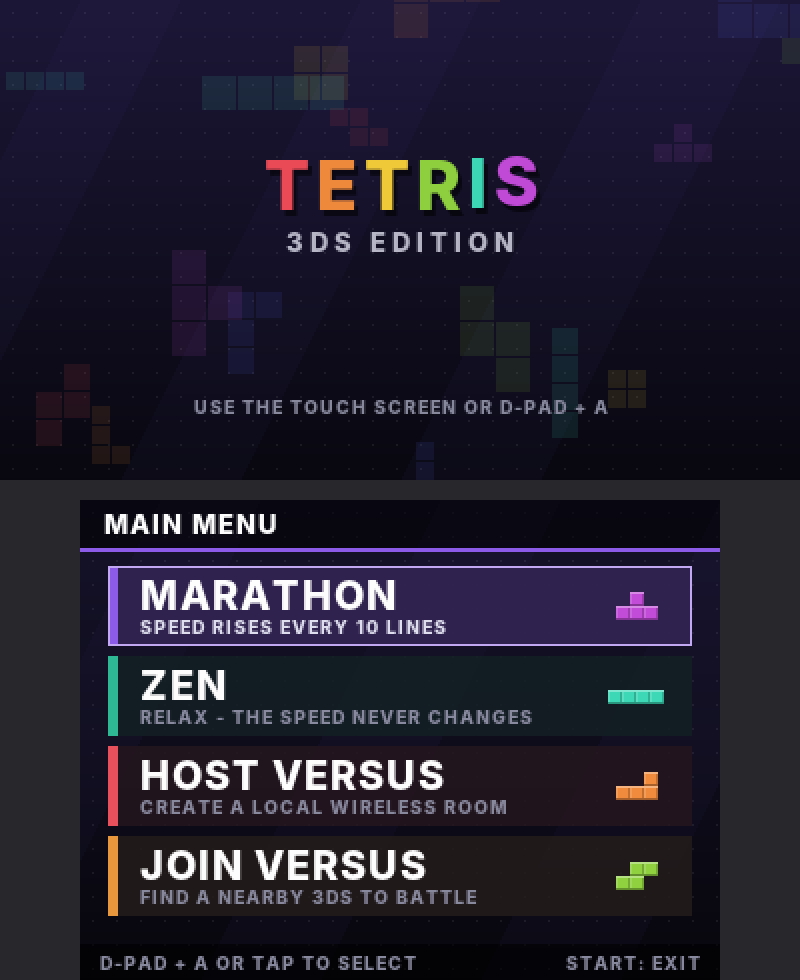
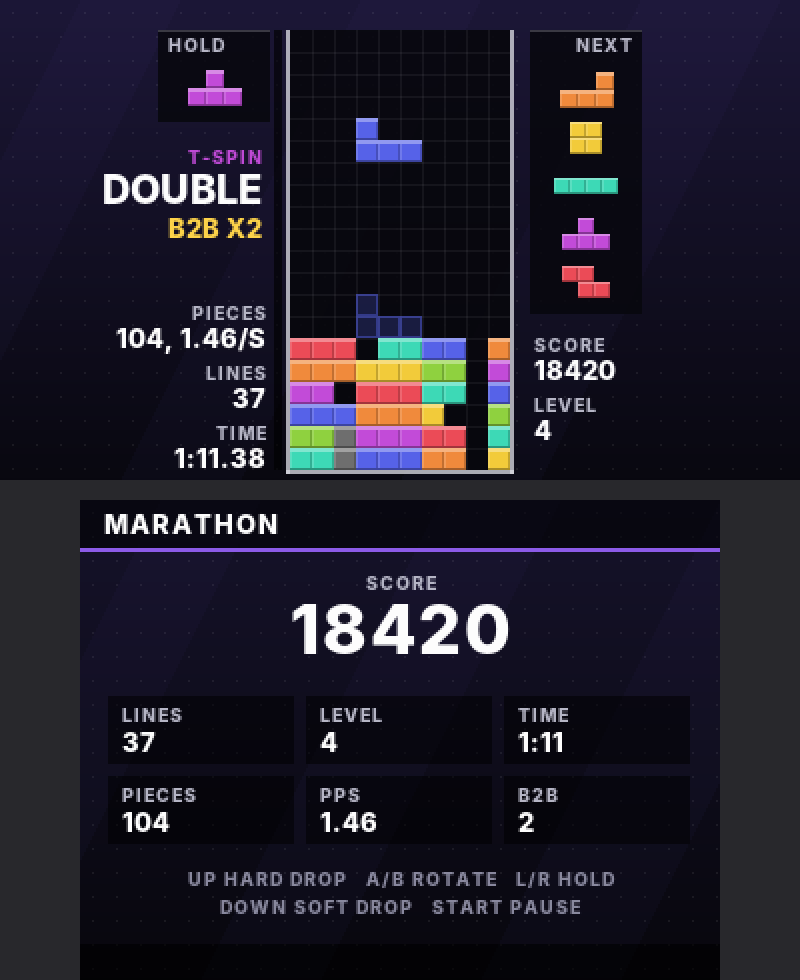
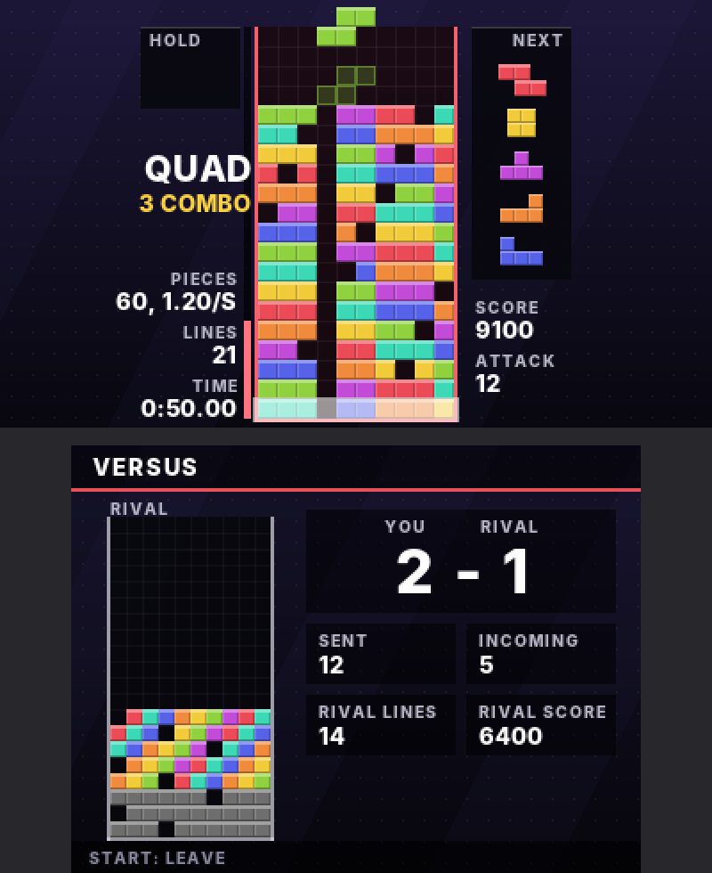

# Tetris 3DS

A simple Tetris for the Nintendo 3DS (homebrew) with a **two-console local
wireless versus mode**. Clearing lines sends garbage rows to the other player.

  

## Features

- TETR.IO-inspired look on both screens: dark backdrop, open-top board, flat
  minos, translucent ghost, HOLD / NEXT panels, live PIECES / PPS / TIME stats,
  line-clear flashes and action text (T-SPIN DOUBLE, QUAD, B2B, COMBO, ALL CLEAR)
- 7-bag randomizer, hold, 5-piece next queue, ghost piece, wall kicks, lock delay,
  T-spin detection, back-to-back and combo tracking, READY / GO countdown
- Music and sound effects, all synthesised on the console at start-up: a
  chiptune arrangement of Korobeiniki for marathon and versus, a calm arpeggio
  piece for zen and the menu, and effects for moves, rotations, drops, line
  clears, T-spins, rising combo pitches, B2B, all clears and incoming garbage.
  Toggle music with **X** and sounds with **Y** on the main menu.
- Solo marathon mode (speeds up every 10 lines)
- Zen mode: like solo, but the speed never increases
- Local wireless versus between two 3DS consoles (no internet needed)
  - Attack roughly follows TETR.IO: double 1, triple 2, quad 4, T-spin
    single/double/triple 2/4/6, +1 for back-to-back, combo bonus, all clear +10
  - Clearing lines first cancels garbage that is incoming to you (red meter)
  - Your rival's board is shown live on the bottom screen
  - Win counter and rematches without reconnecting

## Controls

| Button            | Action               |
|-------------------|----------------------|
| D-Pad / Circle Pad| Move, Down = soft drop |
| Up                | Hard drop            |
| A / X             | Rotate clockwise     |
| B / Y             | Rotate counter-clockwise |
| L / R             | Hold                 |
| START             | Pause (solo) / leave prompt (versus) |

On the main menu, tap a mode on the touch screen or pick one with the D-Pad and A.

## Playing versus

1. Launch the game on both consoles (wireless must be switched on).
2. On one 3DS choose **Host Versus**.
3. On the other choose **Join Versus**. The match starts as soon as they connect.
4. After a round, both players press **A** for a rematch.

## Audio needs the DSP firmware

The 3DS sound hardware needs `/3ds/dspfirm.cdc` on the SD card. Most custom
firmware setups already have it; if not, run the
[DSP1](https://github.com/zoogie/DSP1/releases) homebrew once to dump it. Without
it the game still runs, just silently, and the menu says so.

## Building

Requires [devkitPro](https://devkitpro.org/wiki/Getting_Started) with the
`3ds-dev` group installed.

```sh
make
```

This produces `tetris3ds.3dsx`. Copy it to `/3ds/` on the SD card and launch it
from the Homebrew Launcher on each console.

### Installable .cia (HOME Menu icon)

```sh
make cia MAKEROM=/path/to/makerom BANNERTOOL=/path/to/bannertool
```

This produces `tetris3ds.cia` with its own icon, banner and jingle (from
`meta/`). Install it with FBI (or another CIA installer) on a console running
custom firmware, and Tetris 3DS appears on the HOME Menu. `makerom` comes from
[3DSGuy/Project_CTR](https://github.com/3DSGuy/Project_CTR) and `bannertool`
from [diasurgical/bannertool](https://github.com/diasurgical/bannertool).
`tools/genassets.py` regenerates the icon, banner and jingle.

Every push is also built by GitHub Actions; both the `.3dsx` and the `.cia`
can be downloaded from the workflow run's artifacts.

## Previewing on a PC

`tools/preview.sh preview` builds the renderer for your computer and writes
sample screens to `preview/` as PPM images, so you can tweak the look without
copying to a 3DS.

## Code layout

- `source/game.c` – platform-independent Tetris rules
- `source/net.c` – local wireless (UDS) host / join / send / receive
- `source/render.c` – everything drawn on both screens
- `source/gfx.c` – rectangles, blending and anti-aliased text on the framebuffers
- `source/font_data.c` – generated by `tools/genfont.py` from Inter ExtraBold
  (SIL Open Font License 1.1)
- `source/synth.c` – platform-independent music and sound effect synthesiser
- `source/audio.c` – plays the synthesised sounds through the 3DS DSP (ndsp)
- `source/main.c` – menus, input, effects and the versus protocol
